# Everlasting Community — Frontend

Aplikasi manajemen anggota club Uma Musume (React + Vite + Bootstrap + jQuery).
Entitas data utama: **Anggota**.

## TAHAP TAHAPAN
1. Untuk tampilan awal wesbitenya adalah sebagai berikut
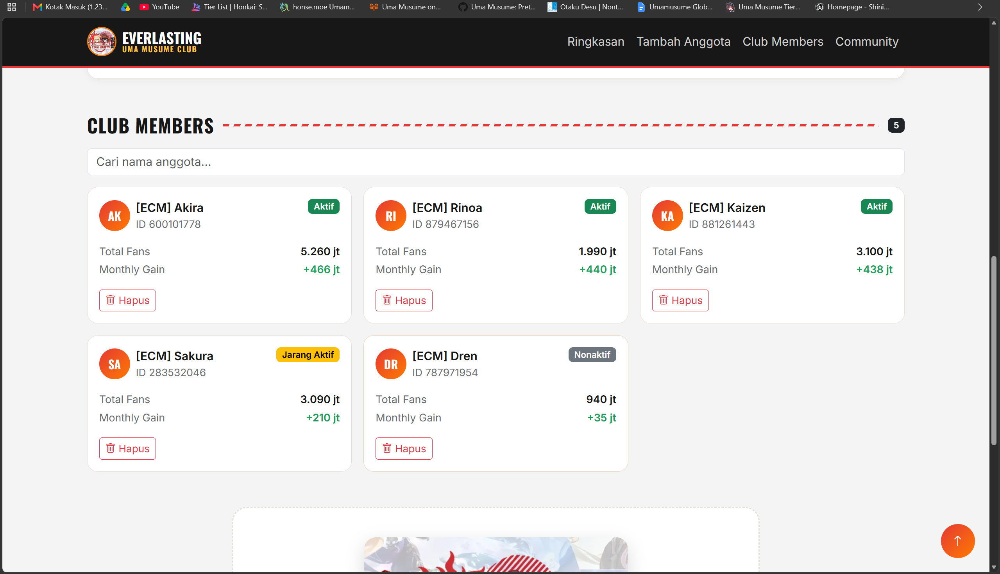

2. Dan kode frontend saya pindahkan ke folder assets agar lebih efesien

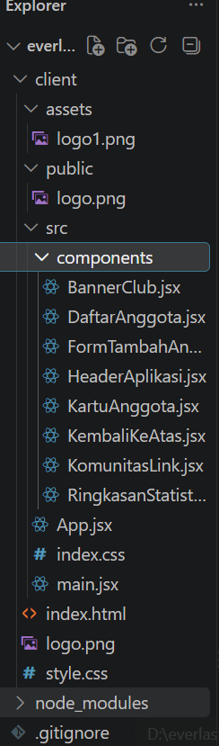

3. Memperbarui isi package.json dan cek versi npx nest
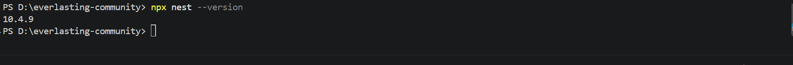

4. Data utama yang dipakai adalah data anggota, ini untuk resource datanya Resource data
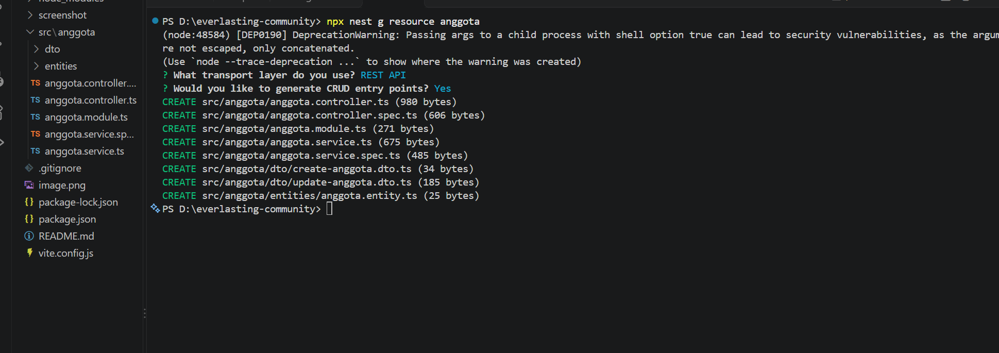
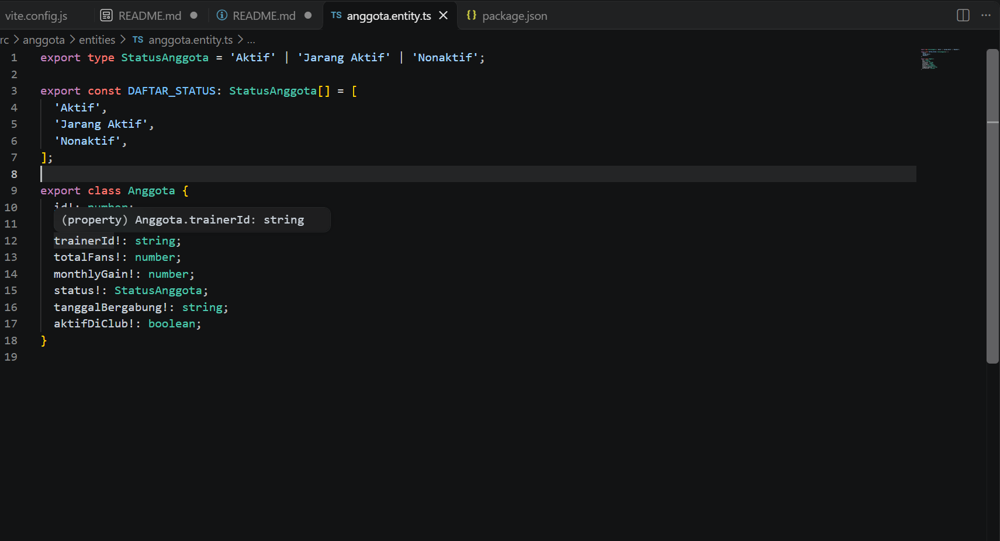

5. Implementasi service
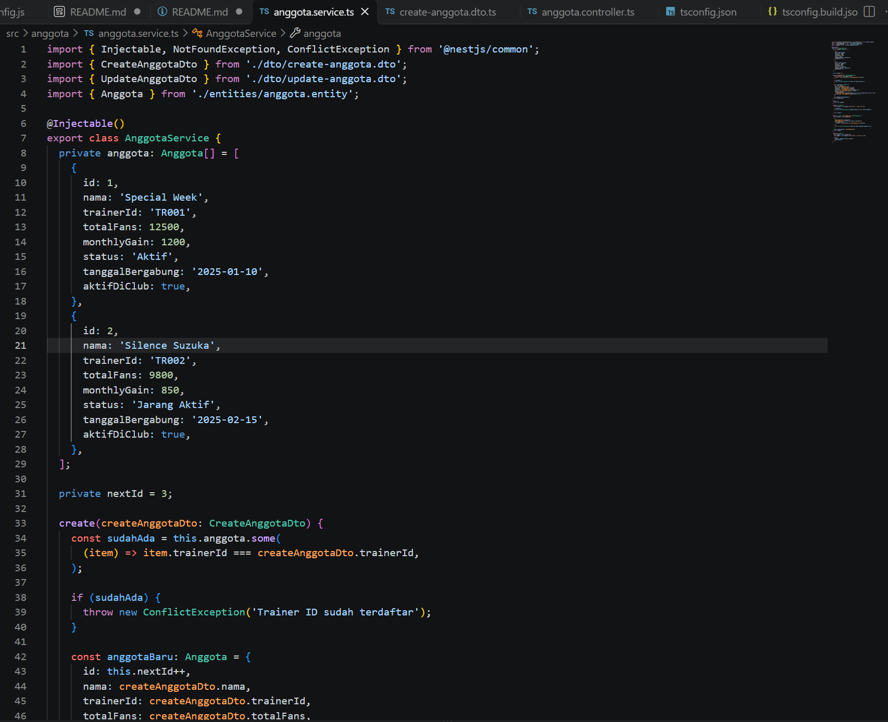
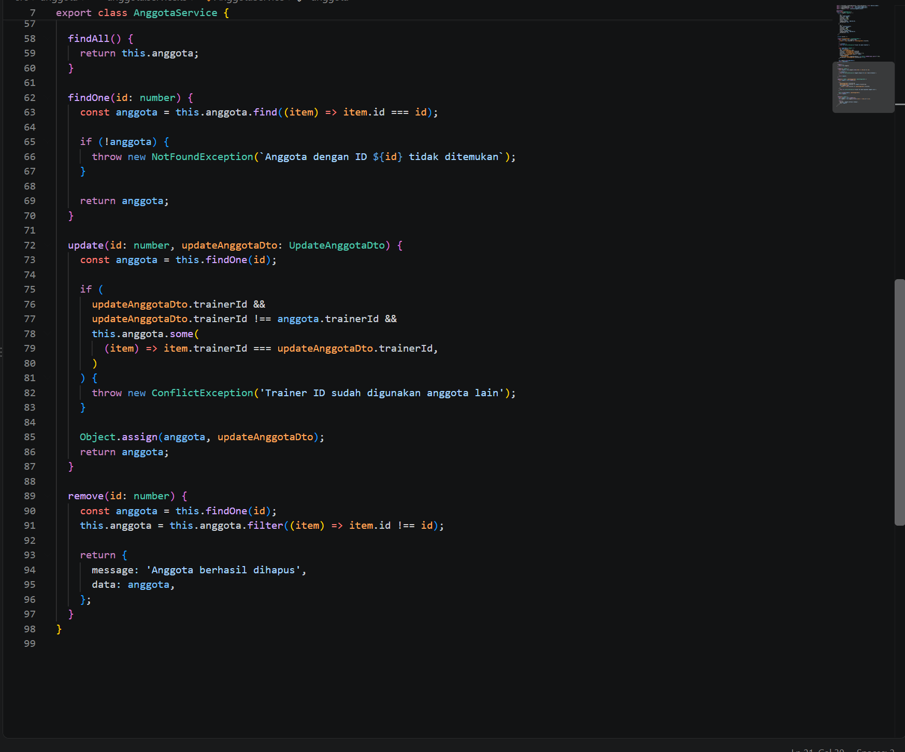

6. Implementasi controller
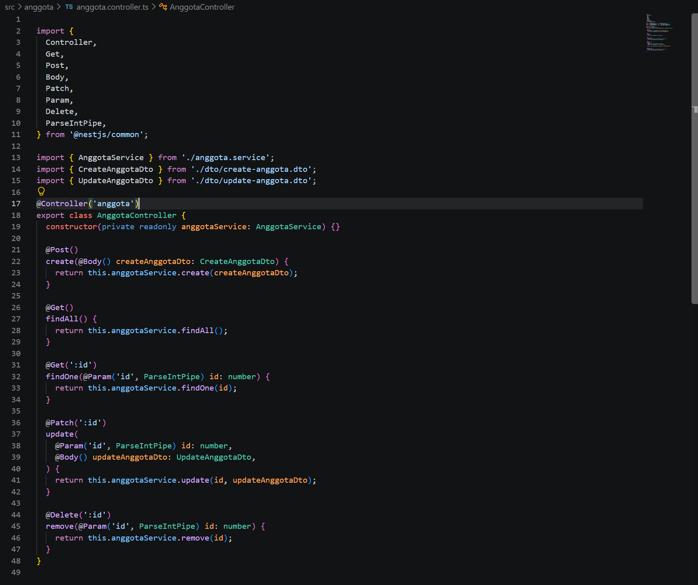

7. Membuat DTO untuk operasi create dan update
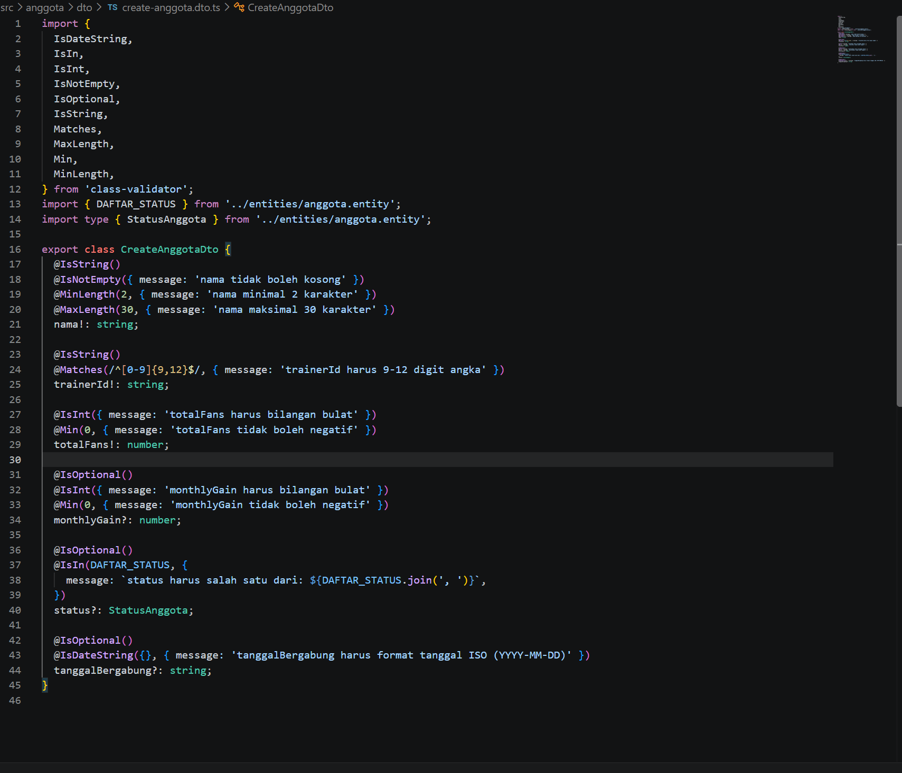
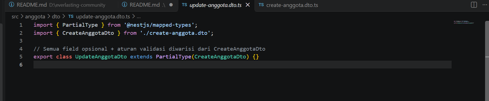

8. Menangani minimal dua skenario error menggunakan exception bawaan NestJS.
- Implementasi ConflictException
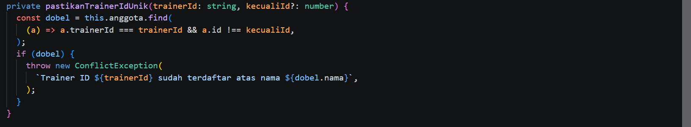
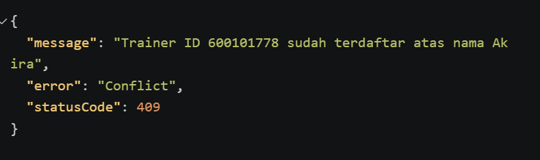

- Implementasi NotFoundException
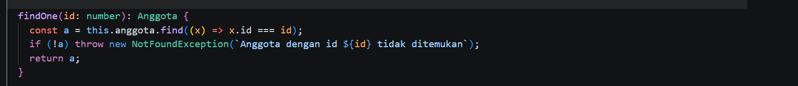
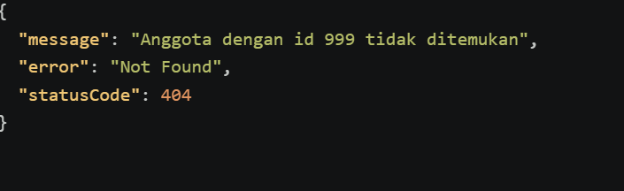

- Pengujian ValidationPipe
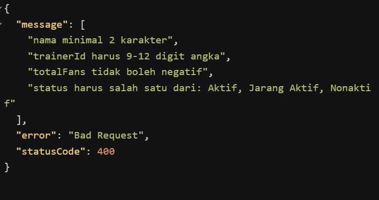

9. Uji COBA seluruh endpoint menggunakan REST Client
- GET semua anggota
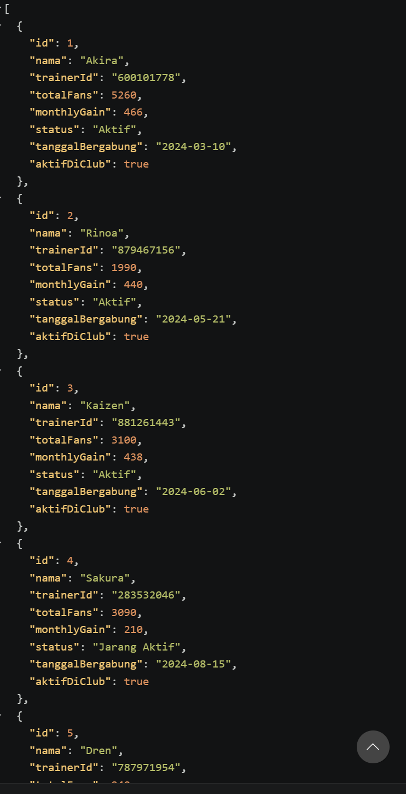

- GET satu anggota
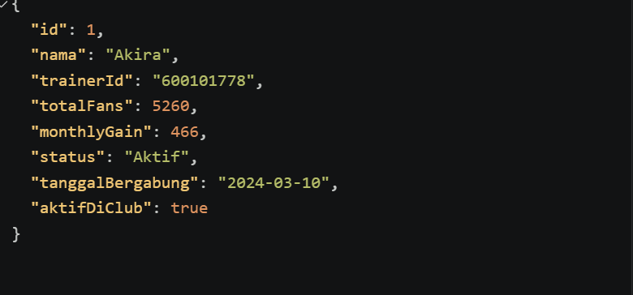

- POST tambah anggota
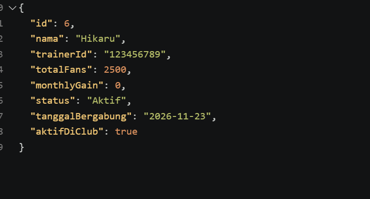

- PATCH ubah anggota
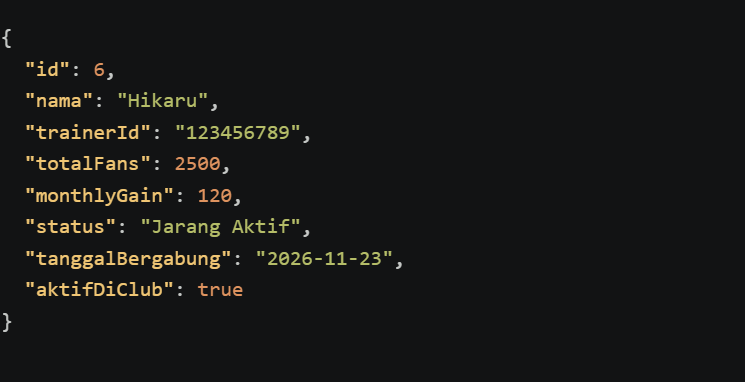

- DELETE hapus anggota
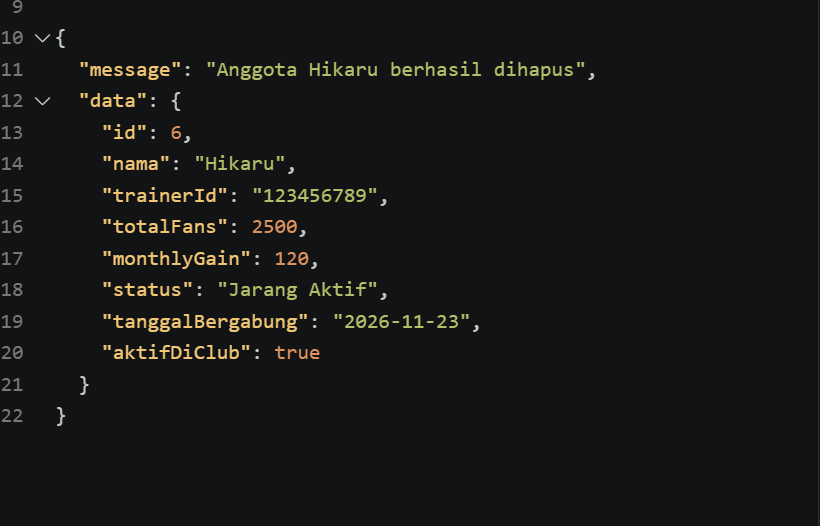

membuktikan bahwa data benar benar telah dihapus
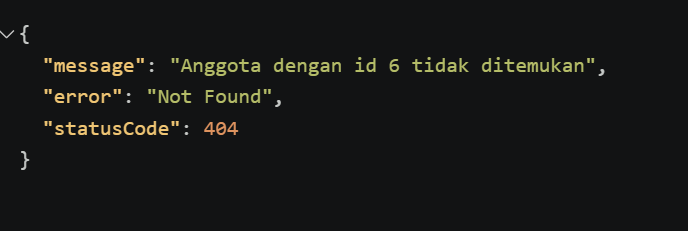

10. menyambungkan backend dan frontend
data anggota awal
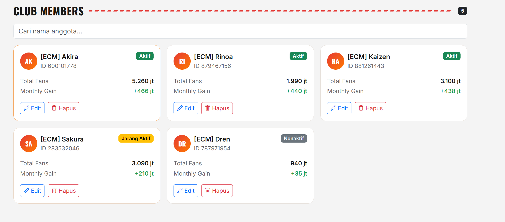

menambah anggota
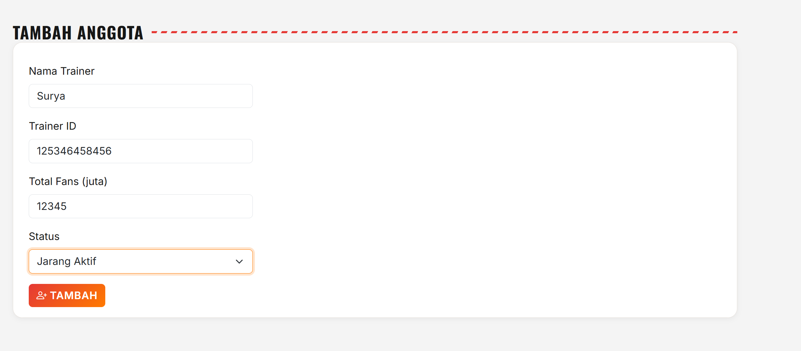

tampilan setelah ditambah
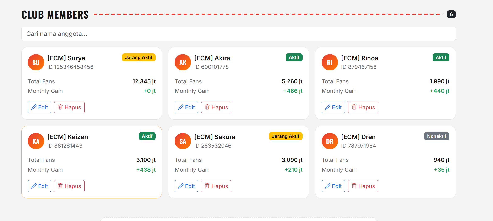

backend juga ikut berubah
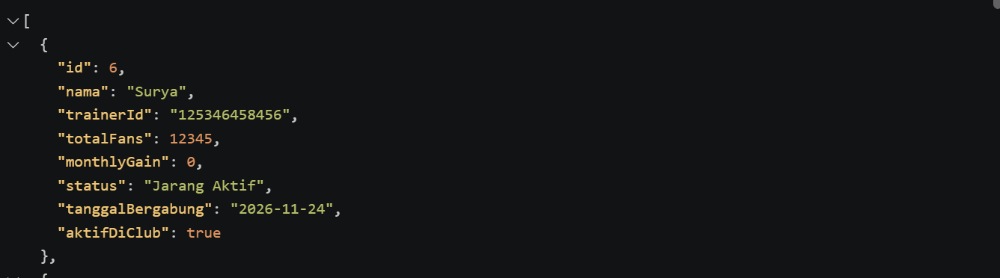